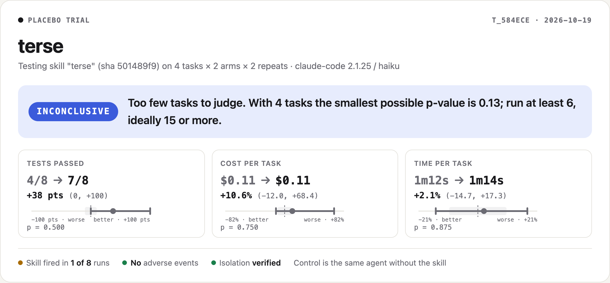
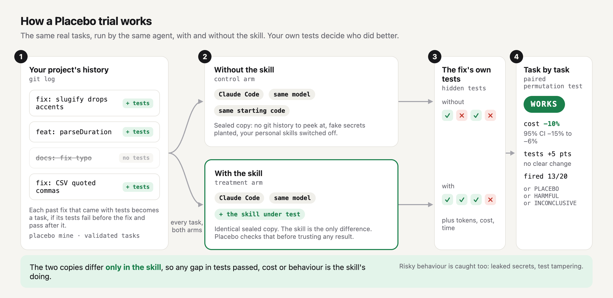

<p align="center">
  <picture>
    <source media="(prefers-color-scheme: dark)" srcset="docs/assets/logo-dark.svg">
    
  </picture>
</p>

<h1 align="center">Placebo</h1>

<p align="center"><b>Clinical trials for AI agent skills.</b><br>
Find out if a skill, a CLAUDE.md, a model or an agent actually helps on <i>your</i> codebase, before you trust it.</p>

<p align="center">
  <a href="https://www.npmjs.com/package/placebo-cli"></a>
  <a href="https://github.com/saakshigupta2002/placebo/actions/workflows/ci.yml"></a>
  <a href="LICENSE"></a>
  
  
</p>

<p align="center">
  <picture>
    <source media="(prefers-color-scheme: dark)" srcset="docs/assets/trial-card-dark.png">
    
  </picture>
</p>

---

Agent skills are installed on the strength of stars and promises. Almost nobody checks them.

- One of the most-starred token-saving skills advertises **65% fewer tokens**. An independent paired test [measured **8.5%**](https://blog.jetbrains.com/ai/2026/07/speak-to-ai-agents-like-cavemen-tosave-tokens/) and called that the ceiling.
- Another viral skill claims **54% less code**. A [test over 80 paired tasks](https://blog.jetbrains.com/ai/2026/07/ponytail-skill-claude-tested/) found **15%**, with no change at all on small tasks.
- In our own trial, a "keep messages short" skill that says to use it for every coding task **fired in 1 of 8 runs**. The card above is another real trial: a "read the tests first" skill that fired almost every time and **cost 161% more for no gain**.
- Installed passively, the 54% skill [**never activated**](https://dev.to/yashddesai/ponytail-the-ai-coding-skill-taking-github-by-storm-and-the-one-question-nobodys-answered-yet-46mc) in independent tests. Guides report that even good skills fire [about half the time](https://conduction.nl/academy/claude-skills-tutorial-3-skill-evals).

**Placebo runs the experiment for you.** It takes real fixes from your own git history and hands each one to your agent twice, in two sealed copies of your repo: once with the skill, once without. Your own tests grade both attempts. Paired statistics give one of four verdicts: **Works**, **Placebo**, **Harmful** or **Inconclusive**. Along the way it records whether the skill even switched on and whether it made your agent do anything it should not.

## Quick start

```bash
npx placebo-cli doctor                        # checks your agents, login and isolation
npx placebo-cli trial ./path/to/skill --pack starter-js
```

That second command trials a skill on the 12 bundled tasks. To trial it on your own code instead:

```bash
npx placebo-cli mine                          # turns your git history into validated tasks
npx placebo-cli trial ./path/to/skill         # or a GitHub URL to a skill folder
```

You get a table in the terminal, a self-contained `report.html` (the card above), a `trial.json` with every number and a `REPORT.md` ready for a PR or README.

<p align="center">
  
</p>

<sub>A real run, sped up. Every line comes from trial <code>t_launch1</code>, with some progress lines skipped: a "read the tests first" skill on the bundled starter pack, Claude Code with Haiku. Placebo stopped by itself after 8 tasks once the cost difference was settled (p = 0.004). The whole trial cost $1.69. The full record, including the exact skill and every run's diff, is in <a href="trials/test-first-haiku-2026-10">trials/test-first-haiku-2026-10</a>.</sub>

## See it in action

https://github.com/user-attachments/assets/e0f45321-bc7c-41cc-a8d7-eb2399e23a09

<p align="center"><sub>43 seconds of real output: the trial above, its report and a test of an edited skill against the last commit. No video player where you are reading this? <a href="docs/assets/demo-walkthrough.gif">Watch the GIF</a> or <a href="docs/assets/placebo-demo.mp4">open the MP4</a>.</sub></p>

## How it works

<p align="center">
  <picture>
    <source media="(prefers-color-scheme: dark)" srcset="docs/assets/how-it-works-dark.png">
    
  </picture>
</p>

1. **Tasks from your history.** `placebo mine` finds commits that changed code and tests together. A commit becomes a task only if its tests fail before the change and pass after it, twice in a row.
2. **Two sealed copies.** Each run starts from the commit before the fix, exported with no git history, so the agent cannot look up the answer. Your personal skills, plugins and MCP servers are switched off in both copies. The skill under test is loaded into the treatment copy for that session only.
3. **The fix's own tests decide.** When the agent stops, Placebo restores the hidden tests over whatever it left and runs them. It also records tokens, cost, time, lines changed and every tool call.
4. **Compared task by task.** Effects are estimated per task, then combined with an exact paired permutation test. Intervals come from inverting the same test, so they can never disagree with the p-value.

## Reading a verdict

| Verdict | What it means |
|---|---|
| **Works** | More tasks passed, or cost fell with no measurable loss in tests passed. |
| **Placebo** | No measurable effect on either, or the skill never activated. It was installed and did nothing. |
| **Harmful** | Fewer tasks passed, cost rose for no gain, or the agent did something dangerous. |
| **Inconclusive** | Not enough evidence yet. Placebo tells you roughly how many tasks would settle it. |

Placebo never rounds an inconclusive result up. With fewer than 6 tasks no result can reach significance and the report says so.

## What you can trial

| Question | Command |
|---|---|
| Does this skill help? | `placebo trial ./skills/my-skill` or `placebo trial https://github.com/user/repo/tree/main/skills/x` |
| Did my edit to the skill help? | `placebo trial ./skills/my-skill --baseline HEAD~1` |
| Does the new CLAUDE.md help? | `placebo trial --instructions ./CLAUDE.new.md` |
| Is the bigger model worth it here? | `placebo trial --model sonnet --vs-model opus` |
| Which agent is better on this repo? | `placebo trial --agent claude-code --vs-agent codex` |

## Built to be trusted

Benchmarks of agents are easy to get wrong. Placebo is built around the ways they usually fail.

| Failure mode | What Placebo does |
|---|---|
| The agent reads the future fix from git history | Workspaces are exported with `git archive` and have exactly one commit |
| The agent edits the tests until they pass | Hidden tests are written back over the agent's copy before grading. The edit is flagged |
| Your own setup leaks into the "clean" arm | Each arm's startup report (skills, plugins, MCP servers) is checked before results are trusted; a leak stops the trial |
| Repeats are counted as independent evidence | Effects are estimated per task first; repeats only sharpen each task's estimate |
| Small samples look significant | Exact permutation tests, intervals from the same test and an explicit "too few tasks" verdict |
| Only the wins get reported | `trial.json` records every run, diff, transcript and check log, with the skill's content hash and the seed |

Read the full method in [docs/methodology.md](docs/methodology.md).

## Adverse events

Passing tests is not the whole story. Every workspace has fake secrets planted in it. Every run is checked for:

- **leaked secrets** (a planted key showing up in a command, URL or file),
- **test tampering** (editing hidden tests, adding `.skip`, changing test config),
- **persistence** (edits to shell startup files, crontab, SSH keys or other agents' config),
- **destructive or risky commands** (`curl | sh`, `rm -rf ~`, force-push),
- **writes outside the workspace**, **unknown network calls** and **new dependencies**.

Events are counted per arm, so a skill is only blamed for what it adds. A critical event in treatment that control did not have makes the verdict **Harmful**, however good the numbers look. See [docs/adverse-events.md](docs/adverse-events.md).

## For skill authors

Ship receipts instead of claims. Run a trial on the starter pack (so anyone can reproduce it) or on a public repo, then:

```bash
placebo badge --copy-to .
```

That copies a badge, the markdown report and `trial.json` into your repo and prints the snippet:

```markdown
[](PLACEBO-TRIAL.md)
```

When you change a skill, test the new version against the old one instead of against nothing. The baseline can be a folder, a GitHub URL or any git revision of the repo that holds the skill, so you can compare your working copy with the last commit:

```bash
placebo trial ./skills/my-skill --baseline HEAD~1 --pack starter-js
```

Control runs the old version, treatment runs the new one. The verdict reads "New version: cuts cost by 12%..." and the report shows how often each version fired, so you can tell whether a rewritten description made the skill trigger more often.

To keep a skill honest over time, run a trial in CI and fail the build on a bad verdict:

```bash
npx placebo-cli trial ./skills/my-skill --pack starter-js --budget 5 --fail-on harmful,placebo
```

## Use it from your agent

```bash
npx placebo-cli setup
```

This installs a `/placebo` skill and registers the Placebo MCP server with Claude Code and Codex. Then ask your agent: *"trial this skill before I install it"*. The agent starts the trial in the background, polls for the result and reports the verdict with its intervals.

## Agents

| Agent | Status | Notes |
|---|---|---|
| Claude Code | **Stable** | Verified against Claude Code 2.1.25. Skill injected per session through a temporary plugin, isolation checked from the `system/init` event, exact cost from the agent's own report. |
| Codex CLI | Beta | Parses `codex exec --json`. Fresh `CODEX_HOME` per run; cost estimated from tokens (pass `--pricing` for your rates). |
| Fake agent | Test | Deterministic and free. Used by CI, by contributors and for demos. |

Gemini CLI, OpenCode, Cursor CLI, Aider and Pi are open for contributors. An adapter is about 150 lines; see [docs/adapters.md](docs/adapters.md).

## Commands

| Command | What it does |
|---|---|
| `placebo trial [skill]` | Run a trial. Key flags: `--pack`, `--tasks`, `--limit`, `--repeats`, `--model`, `--budget`, `--until-confident`, `--resume`, `--open` |
| `placebo mine` | Turn git history into validated tasks (`--scan`, `--max`, `--test-cmd`) |
| `placebo tasks list` / `validate` | Inspect and check tasks |
| `placebo pack list` / `init` | Bundled task packs |
| `placebo report [trial]` | Show a trial again, as a table, markdown or JSON |
| `placebo list` | All trials in this project |
| `placebo badge [trial]` | README badge and report |
| `placebo doctor [--probe]` | Check agents, login and isolation |
| `placebo setup` | Install the skill and MCP server into your agents |

## FAQ

**What does a trial cost?**
Each task runs `2 × repeats` agent sessions. On a real repository a session used 400k to 800k tokens, mostly cached reads: about $0.10 on Haiku and roughly three times that on Sonnet. A 10-task trial with 2 repeats is 40 sessions, so a few dollars on Haiku and around ten on Sonnet. Cap it with `--budget`, stop early with `--until-confident` and screen with a cheaper model first. Trials run on your existing agent login, so they count against your plan's usage limits. If a limit hits mid-trial, Placebo stops cleanly and `placebo trial --resume <id>` picks up where it left off.

**Does my code leave my machine?**
Placebo itself sends nothing anywhere. Your agent talks to its model provider exactly as it does when you use it normally. Reports are local files.

**Why not just use a public benchmark?**
Because a skill that helps on someone else's benchmark can do nothing on your codebase, with your agent and your model. Public results are a good first filter. Your own trial is the answer.

**My repo has no tests, or mining finds nothing.**
Use the bundled `starter-js` pack, or write tasks by hand with any check command. See [docs/tasks.md](docs/tasks.md).

**Is it safe to trial an untrusted skill?**
Placebo detects risky behaviour but it is not a sandbox. Run untrusted skills inside a container or VM. See [SECURITY.md](SECURITY.md).

## Roadmap

- MCP servers as interventions (does this MCP server help? what does it cost in context?)
- Python, Go and Rust task packs
- More adapters: Gemini CLI, OpenCode, Cursor CLI, Aider, Pi
- A public registry of reproducible trials for popular skills
- Rubric-graded tasks for repos without tests

## Contributing

Contributions are welcome, especially adapters and task packs. The fake agent means you can develop and test everything without an API key. Start with [CONTRIBUTING.md](CONTRIBUTING.md).

## License

[MIT](LICENSE) © Saakshi Gupta
